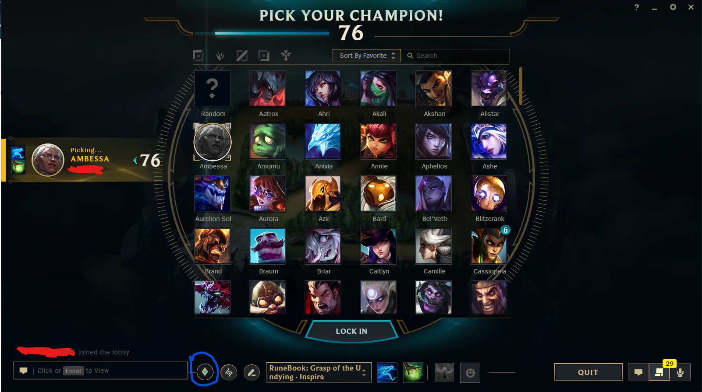
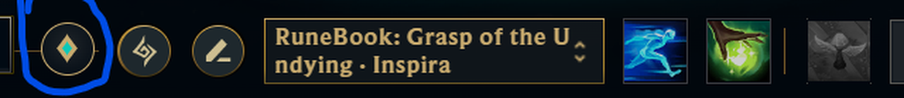

# RuneBook

An app to help manage runes in League of Legends. Save your own rune pages for each champion and get a reminder
when you haven't set your runes.

RuneBook runs on Windows next to the League client. In champ select, a round button appears in the client's
bottom bar; click it to pick one of your pages for the champion you're on, and it goes straight into the client.



The button circled in blue is RuneBook's. Up close, next to the client's own rune buttons:



The page you pick shows up in the client's rune page list; here it's "RuneBook: Grasp of the Undying · Inspiration".

## Features

- **Your pages, per champion.** Every champion starts with Riot's recommended pages; edit, rename, delete or add
  your own. Everything is saved on your PC and works with League closed.
- **Reminder.** If the game is about to start and you haven't set your runes, a reminder would trigger
- **Conflicts.** For a page you play with small variations, press ⇄ next to a row in the editor. When you pick that
  page, RuneBook asks which rune you want for that row before setting the page.

- **Saves pages you make in the client.** Build or edit a page in the client and RuneBook offers to keep it.
- **Step-by-step editor** like the client's, with each rune's description (hold Shift for the full text).
  The earlier editor that shows all runes at once is still in Settings.

## Download and install

1. Download `RuneBook-win.zip` from the [latest release](https://github.com/OmerKori/RuneBook/releases/latest).
2. Unzip it anywhere (for example `C:\RuneBook`) and double-click `RuneBook.exe`.
3. Windows may show **"Windows protected your PC"**, because RuneBook isn't code-signed yet.
   Click **More info** → **Run anyway**. You only need to do this once.

RuneBook then starts with Windows quietly in the tray (near the clock), so you don't need to open it before games.
Click the tray icon or open `RuneBook.exe` again to open the main window. Right-click the tray icon to quit or to
turn off "Start with Windows". If you move the folder, open `RuneBook.exe` once from the new place.

## Settings

⚙ at the top right of the main window, or next to ✕ in the picker:

- When the default page goes into the client: when you hover a champion, when you lock in, or never.
- The warning sound: on or off, volume (▶ plays it), how many seconds before the game, once or until the game starts.
- The rune editor: step by step (like the client) or all runes at once.
- Start with Windows.
- **Report a bug**.

## Reporting bugs

Use ⚙ → **Report a bug**, or [open an issue](https://github.com/OmerKori/RuneBook/issues/new).
The in-app report opens a GitHub issue filled in with what you wrote, RuneBook's version and a few settings.
A full report with the recent log is saved next to RuneBook's data, so you can attach it.
Reports never include your pages or account details.

## Troubleshooting

- **The button doesn't appear / "Waiting for League client…"**: the client may have been started as administrator.
  Run RuneBook as administrator too, or start League normally.
- Your data lives in `%APPDATA%\runebook\`: `runebook.json` (pages and settings, with a `.bak` backup of the
  previous save) and `runebook.log`.

## How it works

RuneBook talks only to the League client running on your PC (the local client API) to read champ select and
your current rune page, and to set rune pages. Champion and rune names and icons come from Riot's Data Dragon.
It doesn't use Riot's web APIs, doesn't send any data anywhere and doesn't touch the game itself.

To place its button on the client, RuneBook reads the client window's position with a small PowerShell script it
writes to `%APPDATA%\runebook\clientWindow.ps1`.

## Build from source

Needs [Node.js](https://nodejs.org) (LTS).

```
npm install
npm start                                # run it
npx electron-builder --win zip --x64     # build dist/RuneBook-<version>-win.zip
```

```
src/main.js          windows, saved pages, champ select handling, settings, bug reports
src/lcu.js           League client connection (league-connect) and setting pages
src/staticData.js    Data Dragon download + cache, stat shards
src/clientWindow.js  follows the League client window
src/log.js           log file
src/preload.js       bridge between the UI and the main process
src/renderer/        the UI (plain HTML/CSS/JS, no build step)
build/               app icon and the step that puts it into RuneBook.exe
```

## License

[MIT](LICENSE)

## Legal

RuneBook isn't endorsed by Riot Games and doesn't reflect the views or opinions of Riot Games or anyone officially
involved in producing or managing Riot Games properties. Riot Games, and all associated properties are trademarks
or registered trademarks of Riot Games, Inc.
